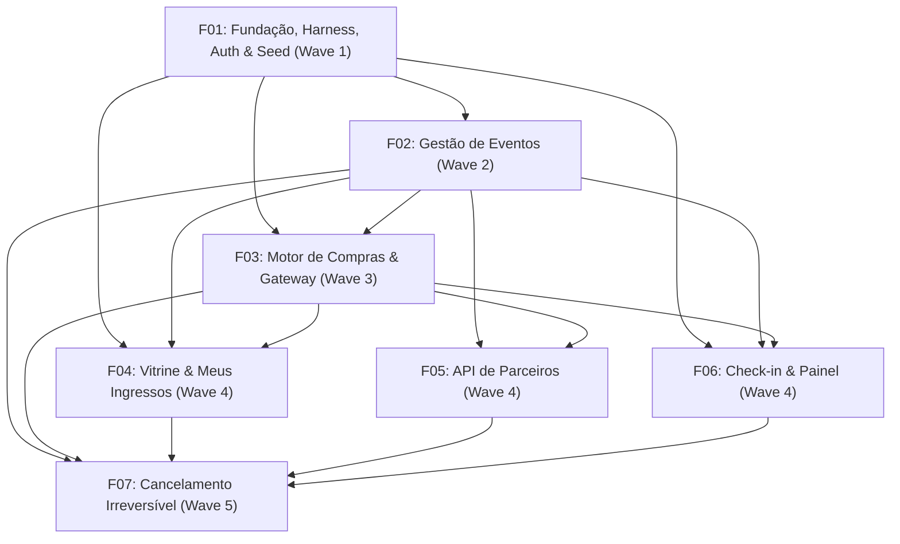

# PRD — Catraca

**Versão:** 1.0.0  
**Data:** 2026-11-25  
**Stack:** TypeScript + Node.js 24 LTS + Fastify 5 (SSR HTML/CSS + REST API) + PostgreSQL 16 + Drizzle ORM + Docker Compose

---

## 1. Visão Geral do Produto

O **Catraca** é uma plataforma web + API para publicação, venda de ingressos, check-in, acompanhamento financeiro e cancelamento de eventos presenciais.

### Perfis de Uso
- **Visitante:** sem login, visualiza a vitrine pública de eventos publicados e não cancelados.
- **Participante:** cria a própria conta (nome, e-mail e senha), faz login/logout, compra ingressos na vitrine e acompanha seus ingressos em **"Meus ingressos"**.
- **Organizador:** contas provisionadas exclusivamente via seed (sem auto-cadastro); cria, edita, publica, opera check-in, visualiza o painel e cancela apenas os próprios eventos.
- **Parceiro:** sistema externo que lista eventos, compra ingressos e consulta status pela API de parceiros autenticada via cabeçalho `X-Api-Key`.

### Status de Ingresso e Check-in
| Interface (UI) | API | Quando se aplica |
| --- | --- | --- |
| `pendente` | `pending` | Compra criada, aguardando resposta assíncrona do gateway |
| `confirmado` | `confirmed` | Gateway aprovou o pagamento |
| `recusado` | `declined` | Gateway recusou o pagamento (libera a vaga) |
| `cancelado` | `cancelled` | Estava pendente quando o evento foi cancelado |
| `estornado` | `refunded` | Estava confirmado quando o evento foi cancelado |

O check-in não é um status: é o atributo booleano independente `checkedIn` (e timestamp opcional `checked_in_at`).

---

## 2. Catálogo de Features (Provides / Consumes)

O produto é dividido em **7 features** (`F01` a `F07`), organizadas em **5 waves** (com a **Wave 4** executada em paralelo):

| ID | Nome | Wave | Pasta de Artefatos |
| --- | --- | --- | --- |
| `F01` | Fundação, Harness, Autenticação e Seed | Wave 1 | `specs/001-f01-foundation-auth/` |
| `F02` | Gestão de Eventos pelo Organizador | Wave 2 | `specs/002-f02-organizer-events/` |
| `F03` | Motor de Compras, Concorrência e Gateway Simulado | Wave 3 | `specs/003-f03-purchase-gateway/` |
| `F04` | Vitrine Pública e Área do Participante ("Meus ingressos") | Wave 4 (Paralela) | `specs/004-f04-storefront-tickets/` |
| `F05` | API de Parceiros (Contrato Fixo) | Wave 4 (Paralela) | `specs/005-f05-partner-api/` |
| `F06` | Check-in e Painel do Organizador | Wave 4 (Paralela) | `specs/006-f06-checkin-dashboard/` |
| `F07` | Cancelamento Irreversível de Eventos e Estorno/Cancelamento | Wave 5 | `specs/007-f07-event-cancellation/` |

### `F01` — Fundação, Harness, Autenticação e Seed
- **Consumes:** Nenhuma (feature raiz).
- **Provides:**
  - Infraestrutura Docker Compose (`app` + `postgres`), scripts `./scripts/up.sh`, `./scripts/down.sh`, `./scripts/gates.sh` e endpoint `/health`.
  - Schema base PostgreSQL + Drizzle ORM (`users`, `sessions`, `events`, `tickets`), mecanismo de migrations e banco isolado de testes `catraca_test`.
  - Seed idempotente criando Organizador A (`org-a@catraca.local`), Organizador B (`org-b@catraca.local`), Participante (`participante@catraca.local`) e configuração da chave de parceiro (`PARTNER_API_KEY`).
  - Cadastro de participante (nome, e-mail, senha), login/logout de participante e organizador por cookie de sessão `HttpOnly`, layout HTML base SSR e middlewares de autenticação/autorização (`requireOrganizer`, `requireParticipant`).

### `F02` — Gestão de Eventos pelo Organizador
- **Consumes:**
  - `F01`: conexão PostgreSQL/Drizzle, tabela `events`, sessão de usuário, middleware `requireOrganizer` e layout SSR.
- **Provides:**
  - Serviço e rotas SSR da área do organizador (`/organizer/events`, `/organizer/events/new`, `/organizer/events/:eventId`) com página de gestão em URL própria (`R04`).
  - Criação de evento sempre em rascunho (`draft`) com validação de nome, data/hora futura, local, lotação >= 1 e preço > 0 (`R01`, `R02`).
  - Edição de evento com validação de data futura (`R01`), proteção de lotação mínima contra vagas ocupadas (`R03`) e atualização de preço vigente apenas para novas compras (`R03`).
  - Ação de publicação (`draft` → `published`, `R02`).
  - Isolamento estrito de visibilidade e operação por organizador (`owner_id`, `R13`).

### `F03` — Motor de Compras, Concorrência e Gateway Simulado
- **Consumes:**
  - `F01`: conexão PostgreSQL/Drizzle, tabelas `users` e `tickets`, configuração de ambiente.
  - `F02`: tabela/entidade `events` (status `published`, `capacity`, `price_cents`) e regra de ocupação para validação de redução de lotação (`R03`).
- **Provides:**
  - Serviço `purchaseTicket(input)` transacional com lock pessimista (`SELECT ... FROM events WHERE id = $1 FOR UPDATE`), cálculo de vagas ocupadas (`pending` + `confirmed`, `R05`) e bloqueio estrito contra overselling sob concorrência (`R07`).
  - Criação imediata de ingresso `pending` com `price_cents` congelado no instante da compra (`R03`, `R06`), código único alfanumérico (`R09`) e validação de cartão de 16 dígitos.
  - Serviço de gateway de pagamento simulado assíncrono (finais `0001`–`0004` + fallback, atrasos reais por padrão e configuráveis em teste) que atualiza `pending` → `confirmed` ou `declined` (liberando vaga, `R08`) com guarda atômica `WHERE id = $1 AND status = 'pending'`.
  - Função `getEventSeatMetrics(eventId)` retornando vagas ocupadas e disponíveis (`R05`).

### `F04` — Vitrine Pública e Área do Participante ("Meus ingressos")
- **Consumes:**
  - `F01`: sessão/autenticação de participante (`requireParticipant`) e layout SSR.
  - `F02`: consulta de eventos publicados e não cancelados (`R02`).
  - `F03`: `purchaseTicket()`, `getEventSeatMetrics()` e atualizações assíncronas do gateway (`R05`, `R06`, `R07`, `R08`, `R09`).
- **Provides:**
  - Vitrine pública (`/`) acessível a visitantes e usuários logados, listando apenas eventos publicados e não cancelados (`R02`) com preço, data, local e disponibilidade.
  - Fluxo de compra na vitrine para participante autenticado (informando cartão de 16 dígitos), exibindo `Ingressos esgotados` quando não há vagas disponíveis ou quando a compra retorna esgotado (`R07`).
  - Página **"Meus ingressos"** (`/my-tickets`) listando evento, status em português (`pendente`, `confirmado`, `recusado`, `cancelado`, `estornado`) e código único de cada ingresso do participante (`R09`).

### `F05` — API de Parceiros (Contrato Fixo)
- **Consumes:**
  - `F02`: consulta de eventos publicados e não cancelados com `startsAt` e `priceCents` (`R02`).
  - `F03`: `purchaseTicket()`, `getEventSeatMetrics()`, consulta de ingressos por `ticketId` e resposta assíncrona do gateway (`R05`, `R06`, `R07`, `R08`).
- **Provides:**
  - Middleware de autenticação `X-Api-Key` retornando `401 {"error":"unauthorized"}` em todas as rotas da API de parceiros.
  - `GET /api/partner/events` retornando lista de eventos à venda com `id`, `name`, `startsAt`, `priceCents`, `availableSeats`.
  - `POST /api/partner/events/:eventId/purchases` com validação na ordem exata (`401` → `422 invalid_request` → `404 event_not_available` → `409 sold_out`) e retorno `202` com `ticketId`, `code`, `status: "pending"`.
  - `GET /api/partner/tickets/:ticketId` retornando `200` com `ticketId`, `code`, `eventId`, `status`, `checkedIn` (de qualquer canal de venda) ou `404 {"error":"ticket_not_found"}`.

### `F06` — Check-in e Painel do Organizador
- **Consumes:**
  - `F01`: middleware `requireOrganizer` e isolamento de sessão (`R13`).
  - `F02`: página de gestão do evento (`/organizer/events/:eventId`, `R04`) e verificação de propriedade (`owner_id`, `R13`).
  - `F03`: tabela `tickets` (compras da vitrine e da API), status, `checked_in`, `code`, `price_cents` congelado e `getEventSeatMetrics()` (`R03`, `R05`, `R12`).
- **Provides:**
  - Operação de check-in na página de gestão do evento (`POST /organizer/events/:eventId/checkin`) seguindo estritamente a ordem de prioridade de `R10` com as 5 mensagens exatas.
  - Painel do evento renderizado na página de gestão exibindo **Confirmados**, **Pendentes**, **Check-ins**, **Vagas disponíveis**, **Receita** (soma do preço vigente na compra dos confirmados) e **Estornados**, consolidando vendas da vitrine e da API (`R12`).

### `F07` — Cancelamento Irreversível de Eventos e Estorno/Cancelamento
- **Consumes:**
  - `F02`: ação/rota na página de gestão do evento, bloqueio de edição e republicação de eventos cancelados (`R02`, `R04`, `R11`).
  - `F03`: transição em massa dos ingressos (`confirmed` → `refunded`, `pending` → `cancelled`) e garantia de que respostas tardias do gateway não alteram ingressos de evento cancelado (`R11`).
  - `F04`: remoção do evento cancelado da vitrine e exibição dos status `estornado`/`cancelado` em "Meus ingressos" (`R02`, `R11`).
  - `F05`: remoção do evento cancelado de `GET /api/partner/events`, resposta `404 event_not_available` em `POST .../purchases` e status `refunded`/`cancelled` em `GET /api/partner/tickets/:ticketId` (`R02`, `R11`).
  - `F06`: comportamento de check-in em evento cancelado (`Evento cancelado`, `R10`) e atualização do painel (`Vagas disponíveis: 0`, `Confirmados: 0`, `Pendentes: 0`, `Check-ins: 0`, `Receita: R$ 0,00`, `Estornados`, `R05`, `R12`).
- **Provides:**
  - Ação irreversível de cancelar evento publicado (`POST /organizer/events/:eventId/cancel`) executada apenas pelo organizador proprietário (`R11`, `R13`).
  - Estorno e cancelamento automático dos ingressos em até 10 segundos (de forma transacional e imediata), com proteção definitiva contra callbacks tardios do gateway (30–40s).

---

## 3. Grafo de Dependências e Waves

### Plano de Waves
- **Wave 1 (Sequencial):** `F01`
- **Wave 2 (Sequencial):** `F02`
- **Wave 3 (Sequencial):** `F03`
- **Wave 4 (PARALELA — 3 branches/worktrees e 3 PRs simultâneos):** `F04`, `F05`, `F06`
- **Wave 5 (Sequencial):** `F07`

---

## 4. Critérios de Aceite por Feature

### `F01` — Fundação, Harness, Autenticação e Seed
- **`F01-AC1`**: Em um clone limpo, `./scripts/up.sh` sobe `db` e `app`, aplica migrations, carrega a seed e deixa `http://localhost:3000/health` respondendo `200` sem nenhum passo manual extra.
- **`F01-AC2`**: `./scripts/down.sh` encerra todos os containers do projeto e libera a porta `3000`; executar `./scripts/up.sh` novamente sobe o ambiente e reaplica a seed sem erros nem duplicações.
- **`F01-AC3`**: `./scripts/gates.sh` executa typecheck e testes automatizados em Docker contra o banco isolado `catraca_test` e passa com código `0`.
- **`F01-AC4`**: Um visitante consegue criar conta de participante (nome, e-mail e senha), entrar e sair; contas de organizador não podem ser criadas pela interface e funcionam via seed (`org-a@catraca.local` e `org-b@catraca.local`).
- **`F01-AC5`** *(R13)*: Visitantes não autenticados e participantes autenticados recebem bloqueio de acesso (`403` ou redirecionamento sem exposição de dados) ao tentar acessar qualquer rota da área de organizador (`/organizer/*`).

### `F02` — Gestão de Eventos pelo Organizador
- **`F02-AC1`** *(R01)*: Organizador autenticado cria evento informando nome, data/hora de início no futuro, local, lotação inteira `>= 1` e preço em reais `> 0`; entradas inválidas (lotação `< 1`, preço `<= 0` ou campos obrigatórios vazios) são rejeitadas.
- **`F02-AC2`** *(R01)*: Data/hora de início no passado (ex.: ontem) é rejeitada tanto na criação quanto na edição do evento.
- **`F02-AC3`** *(R02)*: Todo evento nasce com status `draft` (rascunho) e pode ser publicado (`published`) pelo organizador proprietário.
- **`F02-AC4`** *(R03)*: Ao editar um evento, reduzir a lotação abaixo das vagas ocupadas (`pending` + `confirmed`) é rejeitado; aumentar a lotação é aceito.
- **`F02-AC5`** *(R03)*: Alterar o preço de um evento é aceito e passa a valer apenas para compras criadas após a alteração (sem alterar o valor armazenado em ingressos já comprados).
- **`F02-AC6`** *(R04)*: Cada evento possui página de gestão em URL própria (`/organizer/events/:eventId`) exibindo ações de edição, publicação e estrutura para operação.
- **`F02-AC7`** *(R13)*: Organizador B não visualiza eventos do Organizador A na listagem `/organizer/events` e, ao acessar diretamente `/organizer/events/:eventIdDeA`, não vê nenhum dado do evento (recebe `403`/`404` sem nome, métricas ou ingressos).

### `F03` — Motor de Compras, Concorrência e Gateway Simulado
- **`F03-AC1`** *(R05, R06)*: `purchaseTicket()` cria um único ingresso com status `pending`, responde imediatamente sem aguardar o gateway e contabiliza o ingresso em vagas ocupadas (`pending + confirmed`), reduzindo `availableSeats`.
- **`F03-AC2`** *(R07)*: Quando `occupied >= capacity`, `purchaseTicket()` falha com erro de domínio `sold_out`; sob 30 chamadas simultâneas para um evento de lotação 5, exatamente 5 ingressos são criados e 25 recebem `sold_out` (com lock `FOR UPDATE`).
- **`F03-AC3`** *(R08)*: O gateway simulado valida cartão de 16 dígitos (rejeitando antes de criar ingresso se inválido) e processa assincronamente: `0001` aprova em 2–5s (`confirmed`), `0002` recusa em 2–5s (`declined`, liberando a vaga), `0003` aprova em 30–40s, `0004` recusa em 30–40s, qualquer outro final recusa em 2–5s.
- **`F03-AC4`** *(R03)*: Cada ingresso grava `price_cents` igual ao preço vigente do evento no momento da compra; mudanças posteriores no preço do evento não alteram `price_cents` de ingressos existentes.
- **`F03-AC5`** *(R09)*: Cada ingresso recebe um código único alfanumérico (ex.: 8 caracteres maiúsculos) garantido por restrição `UNIQUE` no banco.

### `F04` — Vitrine Pública e Área do Participante ("Meus ingressos")
- **`F04-AC1`** *(R02)*: A vitrine (`/`) exibe apenas eventos publicados e não cancelados (acessível inclusive deslogado); eventos em rascunho nunca aparecem.
- **`F04-AC2`** *(R06)*: Participante autenticado compra 1 ingresso na vitrine informando cartão de 16 dígitos; a compra nasce `pendente`, redireciona/exibe feedback imediato sem aguardar o gateway e já ocupa vaga.
- **`F04-AC3`** *(R07)*: Quando um evento está sem vagas disponíveis (inclusive se todas estiverem ocupadas por ingressos `pending`), a vitrine exibe exatamente o texto `Ingressos esgotados` (no lugar da compra ou como resposta à tentativa).
- **`F04-AC4`** *(R08, R09)*: Em **"Meus ingressos"** (`/my-tickets`), o participante visualiza nome do evento, status em português (`pendente`, `confirmado`, `recusado`, `cancelado`, `estornado`) e o código único de cada ingresso comprado; com cartão final `0001`, o status passa a `confirmado` em até 5 segundos ao recarregar.

### `F05` — API de Parceiros (Contrato Fixo)
- **`F05-AC1`**: Todas as 3 rotas (`/api/partner/events`, `/api/partner/events/:eventId/purchases`, `/api/partner/tickets/:ticketId`) exigem `X-Api-Key` válido; ausente ou inválido retorna `401` com `{"error":"unauthorized"}`.
- **`F05-AC2`** *(R02, R05)*: `GET /api/partner/events` retorna `200` com array JSON contendo apenas eventos publicados e não cancelados, com os campos `id`, `name`, `startsAt`, `priceCents` e `availableSeats` (conforme R05).
- **`F05-AC3`** *(R06)*: `POST /api/partner/events/:eventId/purchases` valida erros na ordem exata: `422 {"error":"invalid_request"}` (campo faltando, e-mail inválido ou cartão sem 16 dígitos), `404 {"error":"event_not_available"}` (inexistente, rascunho ou cancelado), `409 {"error":"sold_out"}` (sem vaga); quando válido, retorna `202` com `{"ticketId","code","status":"pending"}`.
- **`F05-AC4`** *(R07)*: Sem vaga disponível (incluindo vaga ocupada por ingresso `pending`), `POST /api/partner/events/:eventId/purchases` retorna `409` com `{"error":"sold_out"}`.
- **`F05-AC5`** *(R07)*: Em testes repetidos de carga com 30 requisições simultâneas contra evento novo de lotação 5, a API responde exatamente 5 vezes `202` e 25 vezes `409`.
- **`F05-AC6`** *(R08)*: `GET /api/partner/tickets/:ticketId` retorna `200` com `{"ticketId","code","eventId","status","checkedIn"}` para ingressos de qualquer canal (vitrine ou API), refletindo `confirmed`/`declined` após resposta do gateway, e `404 {"error":"ticket_not_found"}` quando inexistente.

### `F06` — Check-in e Painel do Organizador
- **`F06-AC1`** *(R04)*: A página de gestão do evento (`/organizer/events/:eventId`) inclui o formulário de check-in por código e o painel numérico do evento.
- **`F06-AC2`** *(R10)*: O check-in avalia exatamente na ordem definida em `R10` e exibe as mensagens literais:
  1. Código inexistente ou de outro evento → `Ingresso inválido para este evento`
  2. Evento cancelado → `Evento cancelado`
  3. Ingresso não confirmado (`pending`, `declined`, `cancelled`, `refunded`) → `Ingresso não confirmado`
  4. Ingresso já passou pelo check-in → `Ingresso já utilizado`
  5. Confirmado e ainda não utilizado → `Entrada liberada` (marcando `checkedIn = true`).
- **`F06-AC3`** *(R10)*: Fazer check-in de um ingresso confirmado não altera seu status (`confirmed`), apenas marca `checkedIn = true`, mantendo-o contabilizado em Confirmados e incrementando Check-ins.
- **`F06-AC4`** *(R05, R12)*: O painel exibe exatamente os 6 indicadores definidos em `R12` consolidando vendas da vitrine e da API: **Confirmados** (incluindo já com check-in), **Pendentes**, **Check-ins**, **Vagas disponíveis** (R05), **Receita** (soma do preço vigente em cada compra confirmada) e **Estornados**.
- **`F06-AC5`** *(R03, R12)*: Após alterar o preço de um evento e ocorrer nova compra confirmada, a Receita soma cada ingresso confirmado pelo preço vigente no momento da respectiva compra (ex.: 2 × R$ 100,00 + 1 × R$ 150,00 = R$ 350,00).
- **`F06-AC6`** *(R13)*: Apenas o organizador proprietário do evento consegue visualizar o painel e executar check-in em `/organizer/events/:eventId`.

### `F07` — Cancelamento Irreversível de Eventos e Estorno/Cancelamento
- **`F07-AC1`** *(R11)*: O organizador proprietário pode cancelar um evento publicado pela página de gestão; o cancelamento é irreversível (o evento não pode mais ser editado nem republicado).
- **`F07-AC2`** *(R11)*: Em até 10 segundos após o cancelamento, todos os ingressos `confirmed` do evento tornam-se `refunded` (`estornado`) e todos os `pending` tornam-se `cancelled` (`cancelado`), tanto os comprados na vitrine quanto pela API.
- **`F07-AC3`** *(R11)*: Se um ingresso `pending` estava aguardando gateway lento (cartão final `0003` ou `0004`, 30–40s) quando o evento foi cancelado, ele passa a `cancelled` em até 10s e **permanece `cancelled`** mesmo após a resposta tardia do gateway (passados 45s).
- **`F07-AC4`** *(R10, R11)*: Na página de gestão de um evento cancelado, o check-in exibe `Evento cancelado` (no lugar do campo ou ao submeter qualquer código válido do evento) e a edição fica desabilitada/bloqueada.
- **`F07-AC5`** *(R05, R11, R12)*: No painel de um evento cancelado, `Confirmados = 0`, `Pendentes = 0`, `Check-ins = 0`, `Vagas disponíveis = 0`, `Receita = R$ 0,00` e `Estornados` reflete o total de ingressos anteriormente confirmados (incluindo os que tinham feito check-in).

---

## 5. Critérios Cross-Feature (1 para cada aresta do grafo)

Cada dependência declarada no grafo possui ao menos um critério verificável que comprova que o que a feature provedora entrega chega e funciona na consumidora:

| ID | Aresta | Regras | Critério Cross-Feature | Contrato(s) que cobrem |
| --- | --- | --- | --- | --- |
| `CF-01` | `F01 → F02` | R13 | Sessão autenticada de Organizador A criada pela seed (`F01`) acessa `/organizer/events` e cria evento (`F02`), enquanto participante/visitante de `F01` é bloqueado em `F02`. | `F02/contract.md` |
| `CF-02` | `F01 → F03` | R06, R09 | `purchaseTicket()` (`F03`) persiste ingressos no PostgreSQL e schema provisionados por `F01`, vinculando opcionalmente `user_id` de participante criado em `F01`. | `F03/contract.md` |
| `CF-03` | `F02 → F03` | R02, R03 | `purchaseTicket()` (`F03`) recusa compra em evento em rascunho de `F02`, aceita após publicação em `F02` congelando `price_cents`, e bloqueia redução de lotação abaixo das vagas ocupadas ao editar o evento em `F02`. | `F03/contract.md` |
| `CF-04` | `F01 → F04` | R09 | Participante cadastrado e autenticado via `F01` consegue comprar na vitrine (`F04`) e ver apenas os próprios ingressos em `/my-tickets` (`F04`). | `F04/contract.md` |
| `CF-05` | `F02 → F04` | R02 | Evento criado em rascunho em `F02` não aparece na vitrine (`F04`); ao ser publicado em `F02`, passa a aparecer imediatamente na vitrine (`F04`) com nome, data, local e preço corretos. | `F04/contract.md` |
| `CF-06` | `F03 → F04` | R05, R06, R07, R08 | Compra iniciada na vitrine (`F04`) aciona `F03`: nasce `pendente` ocupando vaga, exibe `Ingressos esgotados` ao atingir lotação, atualiza para `confirmado` com cartão `0001` em até 5s e libera vaga quando recusado (`0002`). | `F04/contract.md` |
| `CF-07` | `F02 → F05` | R02 | Evento criado em rascunho em `F02` fica ausente de `GET /api/partner/events` e retorna `404 event_not_available` em `POST .../purchases` (`F05`); após publicação em `F02`, aparece com `priceCents` e `availableSeats` corretos. | `F05/contract.md` |
| `CF-08` | `F03 → F05` | R05, R06, R07, R08 | Compras via `POST /api/partner/events/:id/purchases` (`F05`) passam pelo motor concorrente e gateway de `F03`: retornam `202 pending`, respeitam lotação exata sob 30 chamadas simultâneas (5×`202`, 25×`409`) e transitam para `confirmed`/`declined` em `GET /api/partner/tickets/:id`. | `F05/contract.md` |
| `CF-09` | `F01 → F06` | R13 | Middleware de organizador de `F01` bloqueia visitante e participante no acesso ao painel e ao endpoint de check-in de `F06`. | `F06/contract.md` |
| `CF-10` | `F02 → F06` | R04, R13 | A página de gestão com URL própria criada em `F02` (`/organizer/events/:eventId`) hospeda o painel e o check-in de `F06`, preservando o isolamento estrito entre Organizador A e Organizador B. | `F06/contract.md` |
| `CF-11` | `F03 → F06` | R03, R05, R10, R12 | Ingressos criados por `F03` (tanto via vitrine `F04` quanto via API `F05`), com seus códigos únicos, status e `price_cents` congelados, são contabilizados com precisão no painel e validados no check-in de `F06` (incluindo código de outro evento retornando `Ingresso inválido para este evento`). | `F06/contract.md` |
| `CF-12` | `F02 → F07` | R11 | Cancelar um evento publicado via `F07` altera seu estado para `cancelled` de modo que `F02` impede edição e republicação do evento. | `F07/contract.md` |
| `CF-13` | `F03 → F07` | R11 | Cancelar um evento via `F07` transita ingressos `confirmed` → `refunded` e `pending` → `cancelled` em até 10s, e o guard do gateway em `F03` impede que resposta tardia (`0003`/`0004`, 30–40s) altere o status `cancelled`. | `F07/contract.md` |
| `CF-14` | `F04 → F07` | R02, R11 | Após cancelamento via `F07`, o evento desaparece da vitrine (`F04`) e os ingressos do participante em "Meus ingressos" (`F04`) exibem `estornado` ou `cancelado`. | `F07/contract.md` |
| `CF-15` | `F05 → F07` | R02, R11 | Após cancelamento via `F07`, o evento desaparece de `GET /api/partner/events`, novas compras retornam `404 {"error":"event_not_available"}` e `GET /api/partner/tickets/:ticketId` (`F05`) retorna `refunded` ou `cancelled`. | `F07/contract.md` |
| `CF-16` | `F06 → F07` | R05, R10, R11, R12 | Após cancelamento via `F07`, o check-in (`F06`) exibe `Evento cancelado` e o painel (`F06`) reflete `Confirmados: 0`, `Pendentes: 0`, `Check-ins: 0`, `Vagas disponíveis: 0`, `Receita: R$ 0,00` e `Estornados` igual aos ingressos previamente confirmados (vitrine + API). | `F07/contract.md` |

---

## 6. Matriz de Rastreabilidade (R01–R13)

| Regra | Critérios no PRD |
| --- | --- |
| `R01` | `F02-AC1`, `F02-AC2` |
| `R02` | `F02-AC3`, `F04-AC1`, `F05-AC2`, `CF-03`, `CF-05`, `CF-07`, `CF-14`, `CF-15` |
| `R03` | `F02-AC4`, `F02-AC5`, `F03-AC4`, `F06-AC5`, `CF-03`, `CF-11` |
| `R04` | `F02-AC6`, `F06-AC1`, `CF-10` |
| `R05` | `F03-AC1`, `F05-AC2`, `F06-AC4`, `F07-AC5`, `CF-06`, `CF-08`, `CF-11`, `CF-16` |
| `R06` | `F03-AC1`, `F04-AC2`, `F05-AC3`, `CF-02`, `CF-06`, `CF-08` |
| `R07` | `F03-AC2`, `F04-AC3`, `F05-AC4`, `F05-AC5`, `CF-06`, `CF-08` |
| `R08` | `F03-AC3`, `F04-AC4`, `F05-AC6`, `CF-06`, `CF-08` |
| `R09` | `F03-AC5`, `F04-AC4`, `CF-02`, `CF-04` |
| `R10` | `F06-AC2`, `F06-AC3`, `F07-AC4`, `CF-11`, `CF-16` |
| `R11` | `F07-AC1`, `F07-AC2`, `F07-AC3`, `F07-AC4`, `F07-AC5`, `CF-12`, `CF-13`, `CF-14`, `CF-15`, `CF-16` |
| `R12` | `F06-AC4`, `F06-AC5`, `F07-AC5`, `CF-11`, `CF-16` |
| `R13` | `F01-AC5`, `F02-AC7`, `F06-AC6`, `CF-01`, `CF-09`, `CF-10` |

---

## 7. Fora de Escopo

Conforme o brief do produto, ficam explicitamente **fora de escopo**:
- Deploy em nuvem ou qualquer ambiente além do ambiente local via Docker.
- Integração com gateway de pagamento real, envio de e-mails ou notificações push/SMS.
- Aplicativo mobile e polimento visual avançado (nenhum critério avalia design).
- Auto-cadastro de organizadores pela interface (contas de organizador existem somente via seed).
- Compra de múltiplos ingressos em uma única transação, mapa de assentos numerados, cancelamento ou transferência de ingresso pelo participante.
- Atualização em tempo real na interface (WebSockets/SSE); recarregar a página para ver o novo status atende ao requisito.
- Conversão multi-fuso horário complexa (armazenamento em UTC / ISO-8601 com offset padrão `-03:00` atende ao fluxo).
